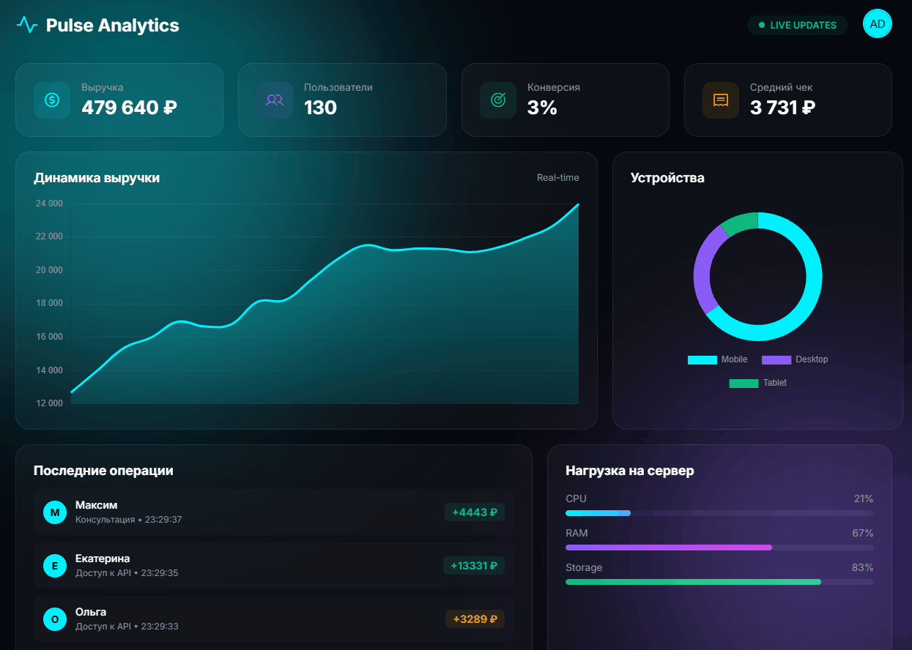

# 📊 Pulse - Real-time Analytics Dashboard

## 🚀 О проекте
**Pulse** — это премиальный дашборд для аналитики в реальном времени. Проект демонстрирует работу с REST API, асинхронным JavaScript (Fetch API) и визуализацией данных с помощью Chart.js.

### 🔥 Ключевые фичи
*   **Real-time обновления:** Данные на графике и KPI-карточках обновляются каждые 2 секунды без перезагрузки страницы.
*   **Анимация чисел:** Значения KPI плавно "набегают" до новых цифр (кастомная функция анимации).
*   **Современный UI:** Стиль Glassmorphism, неоновые градиенты и эффект "пульсирующей" трансляции (Live).
*   **Chart.js:** Плавный линейный график с градиентной заливкой.
*   **Flask API:** Бэкенд генерирует реалистичные данные о продажах.

## 🛠 Технологии
*   **Backend:** Python 3, Flask
*   **Frontend:** HTML5, CSS3, JavaScript (Fetch API)
*   **Библиотеки:** Chart.js, Phosphor Icons

## ⚙️ Запуск
1. Установите Flask: `pip install Flask`
2. Запустите сервер: `python app.py`
3. Откройте `http://127.0.0.1:5000`